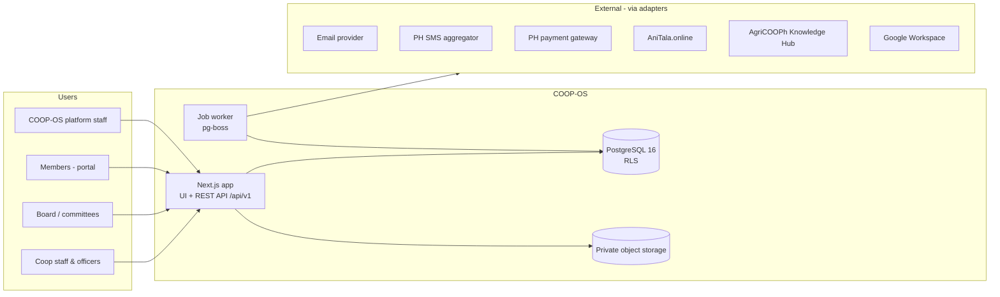
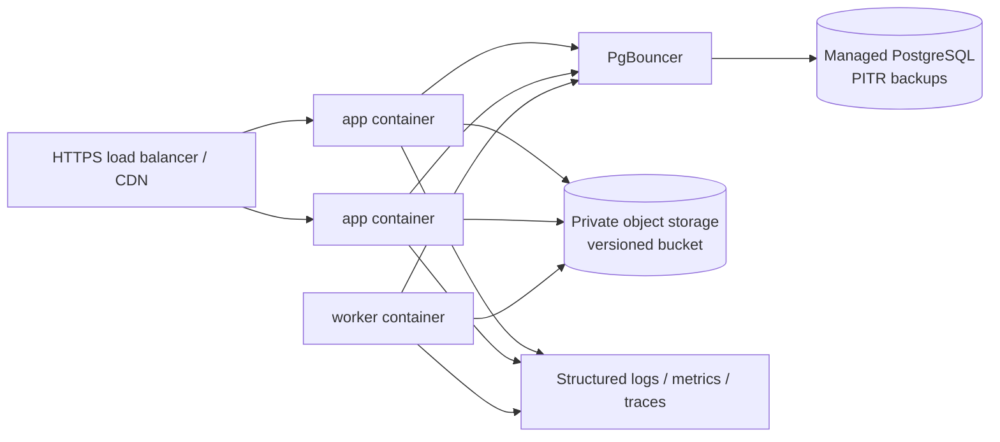

# COOP-OS — System Architecture

Version 0.1 · Draft for approval

## 1. Context



One deployable web application plus one worker process (same codebase, different entry
point). This is a **modular monolith**: module boundaries are enforced in code, not by network
hops, which keeps operations simple for an early-stage SaaS while allowing extraction later.

## 2. Code organisation

```
/
├─ prisma/
│  ├─ schema/                 # multi-file Prisma schema, one file per module
│  └─ migrations/             # Prisma migrations + raw SQL for RLS, triggers, constraints
├─ src/
│  ├─ app/                    # Next.js App Router
│  │  ├─ (auth)/              # sign-in, sign-up, invite acceptance, reset
│  │  ├─ (tenant)/[org]/      # tenant app, org slug in URL
│  │  ├─ (portal)/[org]/me/   # member self-service portal
│  │  ├─ (platform)/admin/    # SaaS administration portal
│  │  └─ api/v1/              # REST route handlers (thin)
│  ├─ server/
│  │  ├─ platform/            # tenancy, auth, rbac, audit, numbering, files,
│  │  │                       # notifications, approvals, posting, custom-fields, jobs
│  │  ├─ modules/
│  │  │  ├─ membership/       # each: schema.ts (zod), service.ts, policy.ts,
│  │  │  ├─ share-capital/    #       repo.ts, events.ts, *.test.ts
│  │  │  ├─ finance/ …
│  │  └─ integrations/        # adapter interfaces + mock/real implementations
│  ├─ components/             # shadcn/ui-based design system + domain components
│  └─ lib/                    # money, dates (Asia/Manila), phone, PSGC, formatting
├─ tests/                     # e2e (Playwright), isolation suites
├─ docker/ , docker-compose.yml
└─ docs/
```

**Module rules**

1. A module's tables are written only by that module's service.
2. Modules talk to each other through exported service functions or domain events — never by
   querying another module's tables for writes.
3. Route handlers and server actions are thin: authenticate → build `RequestContext` → call
   service → map result. Business rules live in services, so API and UI behave identically.
4. Every service function takes a `ctx: RequestContext` (`userId`, `orgId`, `branchIds`,
   `permissions`, `requestId`, `ip`) as its first argument.

## 3. Request lifecycle

```mermaid
sequenceDiagram
  participant B as Browser
  participant N as Next.js (middleware)
  participant H as Route handler / Server action
  participant S as Service
  participant P as Policy (RBAC/ABAC)
  participant D as Postgres
  B->>N: request + session cookie (+ CSRF token for mutations)
  N->>N: rate limit, session lookup, resolve org from URL
  N->>H: forward
  H->>H: load membership in org → RequestContext
  H->>S: service.fn(ctx, zodParsedInput)
  S->>P: authorize(ctx, action, resource)
  P-->>S: allow / deny (403)
  S->>D: BEGIN; set_config('app.org_id', ctx.orgId, true); set_config('app.user_id', …)
  S->>D: queries (RLS enforces org)
  S->>D: insert audit_log; COMMIT
  S-->>H: result
  H-->>B: JSON / rendered page
```

## 4. Tenant isolation strategy

**Model:** shared database, shared schema, `organization_id` column on every tenant-owned
table. Chosen over schema-per-tenant (migration fan-out, connection pressure at hundreds of
tenants) and database-per-tenant (cost) for a market of many small cooperatives. Large
Enterprise tenants can later be moved to a dedicated database with the same schema.

Isolation is enforced at **three independent layers**; a bug in any one is caught by the
others.

### Layer 1 — Application

- The active organization comes from the URL slug and is verified against the user's
  `organization_memberships` row on every request. It is **never** read from a request body.
- Repositories receive `ctx` and always filter by `ctx.orgId`.
- IDs are UUIDv7; lookups are `WHERE organization_id = $org AND id = $id`.

### Layer 2 — PostgreSQL Row-Level Security

```sql
-- app connects as role coopos_app: NOSUPERUSER, NOBYPASSRLS, not table owner
ALTER TABLE members ENABLE ROW LEVEL SECURITY;
ALTER TABLE members FORCE ROW LEVEL SECURITY;

CREATE POLICY tenant_isolation ON members
  USING      (organization_id = current_setting('app.org_id', true)::uuid)
  WITH CHECK (organization_id = current_setting('app.org_id', true)::uuid);
```

- `withTenant(orgId, fn)` opens an interactive Prisma transaction and runs
  `SELECT set_config('app.org_id', $1, true)` (transaction-local) before `fn`. Because the
  setting is transaction-local it is safe with PgBouncer in transaction mode.
- If `app.org_id` is unset, `current_setting(..., true)` is `NULL` and the policy matches
  **no rows** — fail closed.
- Platform-level tables (`plans`, `organizations` registry, `platform_users`) are accessed
  through a separate `coopos_platform` role used only by the admin portal services.
- Migrations run as `coopos_owner`; the app never uses the owner role.
- A CI check queries `pg_class` / `pg_policies` and fails the build if any table with an
  `organization_id` column lacks RLS + FORCE + a policy.

### Layer 3 — Referential integrity across tenants

Child tables reference parents with **composite foreign keys** that include the tenant:

```sql
ALTER TABLE share_capital_transactions
  ADD FOREIGN KEY (organization_id, member_id)
  REFERENCES members (organization_id, id);
```

so a row in tenant A cannot point at a member in tenant B even if the application passed a
foreign ID.

### Cross-organization access

- **Users in several coops**: one `users` row, many `organization_memberships`; the session
  holds the active org; switching org re-evaluates permissions.
- **Federations**: a federation is itself an organization. An affiliation record
  (`federation_affiliations`) grants nothing by itself. A member coop explicitly issues a
  **data-sharing grant** listing datasets (e.g. "aggregate membership statistics",
  "submitted reports") and an expiry. Federation views read only *published aggregates or
  explicitly shared documents*, produced by the member coop's tenant context — the federation
  never queries the member coop's tables directly.
- **Platform support access**: platform staff have no tenant access by default. A tenant admin
  can grant a time-boxed support session (read-only by default), which is logged in both the
  platform and the tenant audit log and shown as a banner to tenant admins.

## 5. Key domain mechanisms

### 5.1 Posting engine (subledger → general ledger)

```
module service ──emits──▶ PostingRequest{ eventType, amount lines, refs, date, branch }
                              │
                              ▼
            posting_rules (per org: eventType → debit/credit accounts, by product/branch)
                              │
                              ▼
            journal_entry (status POSTED, source=module/ref) + journal_lines
```

- Posting rules are data, seeded from a default template per cooperative type and editable
  by authorised accountants.
- If Finance is not enabled, requests are stored as `pending_postings`; enabling Finance lets
  the accountant post or dismiss them in bulk.
- Database guarantees: a deferred constraint trigger asserts `SUM(debit) = SUM(credit)` and
  ≥ 2 lines when an entry becomes `POSTED`; a trigger rejects UPDATE/DELETE on posted entries
  and their lines; posting into a closed `financial_period` is rejected.

### 5.2 Approval engine

- `approval_policies` per org × document type: ordered steps, each with eligible role(s),
  optional committee, amount range, and quorum (e.g. 2 of 3 credit committee members).
- `approval_requests` / `approval_actions` record every decision with comment.
- Invariants enforced in the engine (not per module): maker ≠ approver; an approver cannot
  act twice on the same step; a user who is the *subject* (e.g. loan borrower who is also an
  officer) cannot approve.

### 5.3 Numbering service

`number_sequences(organization_id, key, branch_id, prefix_pattern, next_value)` updated with
`SELECT … FOR UPDATE` in the same transaction as the document insert, giving gap-free numbers
for receipts and vouchers. Patterns support tokens like `{YYYY}`, `{BR}`, `{SEQ:6}`.

### 5.4 Custom fields

`custom_field_definitions` (entity, key, label, type, options, required, validation) and a
`custom_fields JSONB` column on the entity. The service builds a Zod schema at runtime from
the definitions, so custom fields get the same validation as built-in ones. Indexed with GIN
for search.

### 5.5 Files

Upload: client requests an upload intent → server authorises, creates `files` row
(`pending`), returns a presigned PUT URL scoped to `org/{orgId}/{uuid}` → client uploads →
server confirms (size, MIME sniff, checksum) → `active`. Download: authorised endpoint returns
a presigned GET URL valid ~60 s. No public bucket, no static file route. Malware scanning hook
in the worker (ClamAV adapter).

### 5.6 Background jobs

pg-boss queues in the same Postgres: notification delivery, interest accrual and posting,
loan delinquency aging and PAR snapshots, document expiry reminders, scheduled report
generation, export generation for large datasets, trial expiry. Jobs carry `orgId` and run
inside `withTenant`.

### 5.7 Domain events

An `outbox` table written in the same transaction as the change; the worker dispatches to
in-process subscribers (notifications, posting, search indexing) and to integration webhooks.
Guarantees at-least-once delivery; subscribers are idempotent.

## 6. Philippine localisation layer (`src/lib`)

- `money.ts`: `Decimal` helpers, PHP formatting `₱1,234.56`, configurable rounding (half-up
  default, banker's optional).
- `dates.ts`: all storage in UTC `timestamptz`; business dates (`date` type) interpreted in
  `Asia/Manila`; display formats configurable per org.
- `phone.ts`: parse/format PH mobile and landline numbers to E.164.
- `psgc`: reference tables of PSA's Philippine Standard Geographic Code, refreshed by a
  maintenance script; addresses store PSGC codes + free text.
- Fiscal year configurable (default calendar year).

## 7. Deployment



- Docker image built once, promoted dev → staging → production.
- Configuration via environment variables validated at boot with Zod; the app refuses to
  start with missing secrets (no fallbacks).
- CI: typecheck, lint, unit + integration tests against a Postgres service container,
  RLS coverage check, Playwright smoke tests, dependency audit, image build.
- Observability: pino structured logs with `requestId`/`orgId` (no PII in logs),
  OpenTelemetry traces, error tracking, uptime checks.
- Backups: managed PITR + nightly logical dump to a separate account; object storage
  versioning; quarterly restore drill.

## 8. Architecture Decision Records (summary)

| ADR | Decision | Status |
|---|---|---|
| 001 | Replace AI Studio prototype rather than migrate it | Proposed |
| 002 | Modular monolith on Next.js App Router; services independent of Next | Proposed |
| 003 | PostgreSQL 16 + Prisma; raw SQL migrations for RLS/triggers | Proposed |
| 004 | Shared-schema multi-tenancy with RLS + composite FKs | Proposed |
| 005 | Cookie-based DB sessions (Better Auth); permission model owned by COOP-OS | Proposed |
| 006 | Exact decimal money (`NUMERIC`, `decimal.js`); no floating point | Proposed |
| 007 | Subledgers post to GL via configurable posting rules; posted entries immutable | Proposed |
| 008 | Postgres-backed jobs (pg-boss) and transactional outbox; no Redis at MVP | Proposed |
| 009 | Private S3-compatible storage with short-lived signed URLs | Proposed |
| 010 | Integrations only through adapter interfaces with mock implementations until specs exist | Proposed |

Each ADR will get its own file under `docs/adr/` when accepted.
