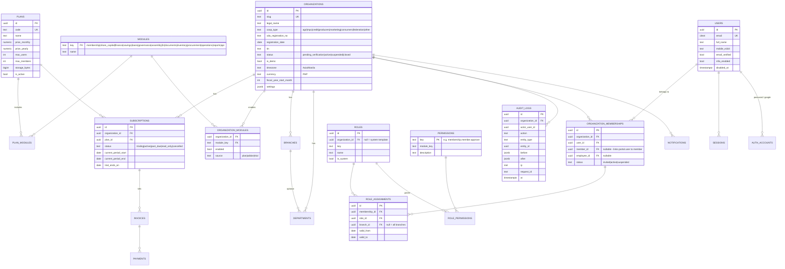
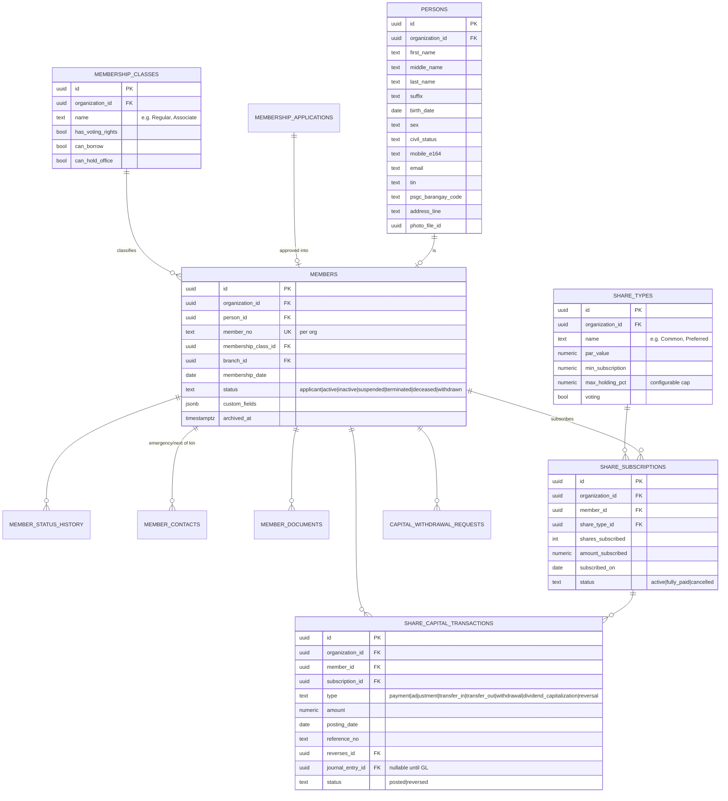
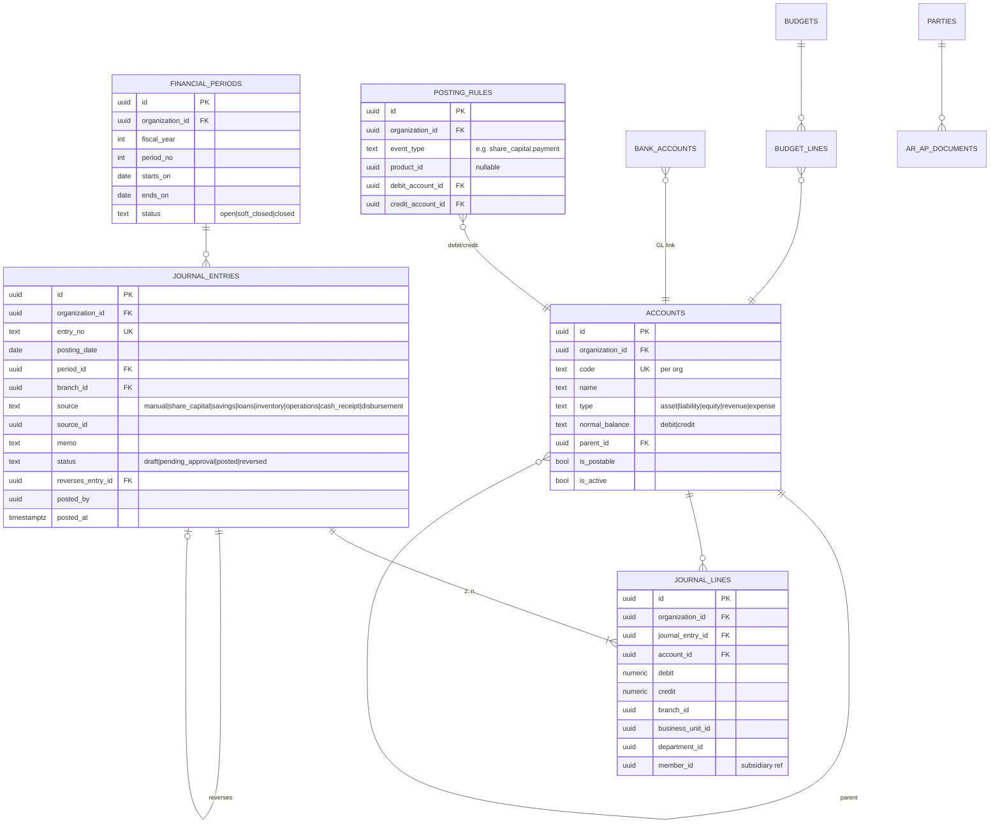
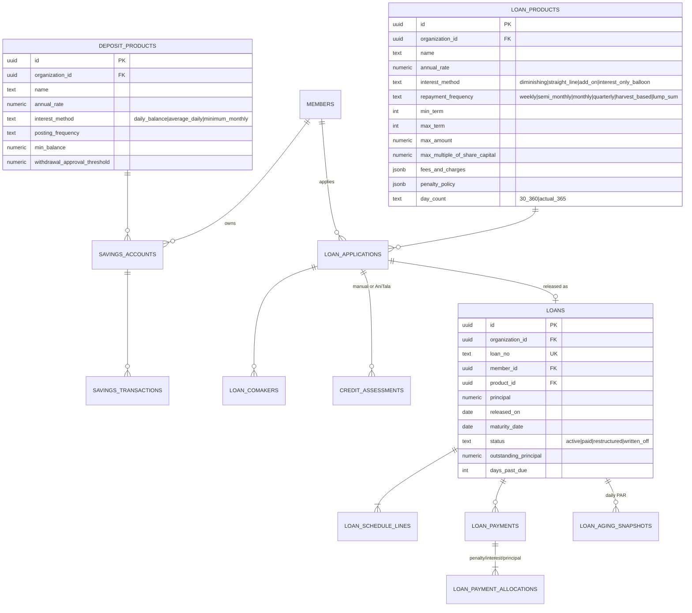
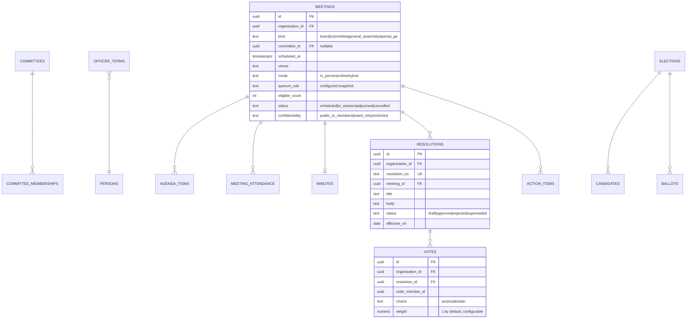

# COOP-OS — Database Design & ERD

Version 0.1 · Draft for approval · PostgreSQL 16

## Conventions

- Primary keys: `id uuid` (UUIDv7, time-ordered).
- Every tenant-owned table: `organization_id uuid NOT NULL`, RLS enabled + forced,
  `UNIQUE (organization_id, id)` to support composite foreign keys.
- Timestamps: `created_at`, `updated_at` (`timestamptz`), `created_by`, `updated_by`.
- Archival: `archived_at`, `archived_by` on records that must be retained (no hard delete).
- Money: `numeric(18,2)`; rates `numeric(9,6)`; quantities `numeric(18,4)`.
- Status columns are Postgres enums or `text` + `CHECK`.
- Business dates (`posting_date`, `membership_date`) use `date`; instants use `timestamptz`.
- Names in `snake_case`; Prisma models map with `@@map`.

Legend in diagrams: **(T)** = tenant table with RLS. Platform tables have no `organization_id`.

---

## 1. Platform core

Additional platform-core tables: `branches` (T), `departments` (T), `approval_policies` (T),
`approval_requests` (T), `approval_actions` (T), `number_sequences` (T),
`custom_field_definitions` (T), `files` (T), `notifications` (T), `notification_preferences`
(T), `outbox_events` (T), `support_access_grants` (T), `platform_users`,
`platform_announcements`, `support_tickets`, `api_keys` (T), `webhook_endpoints` (T),
`integration_logs` (T), `psgc_regions/provinces/cities/barangays` (reference),
`data_sharing_grants` (T, for federations), `consent_records` (T), `dsar_requests` (T).

`audit_logs` is append-only: the app role has `INSERT, SELECT` only; a trigger blocks
`UPDATE/DELETE`. Partitioned by month.

---

## 2. Membership & share capital

Balances (paid-up, unpaid subscription) are derived from transactions and materialised in
`member_share_balances` (updated in the same transaction) for fast reads; a nightly job
re-verifies them.

---

## 3. Finance (double entry)

DB-level guarantees: `CHECK (debit >= 0 AND credit >= 0 AND (debit = 0) <> (credit = 0))`
per line; deferred constraint trigger for balance at posting; immutability trigger for posted
entries; period status check on insert. Other tables: `cash_receipts`, `disbursement_vouchers`,
`bank_accounts`, `bank_transactions`, `parties` (customers/suppliers/others),
`ar_ap_documents`, `budgets`, `budget_lines`, `tax_codes`, `pending_postings`.

Financial statements are computed from `journal_lines` grouped by account type/period, with
`account_period_balances` snapshots written at period close.

---

## 4. Savings & loans

---

## 5. Governance & general assembly

Voting eligibility is evaluated by a configurable rule set (membership class, good standing
criteria such as paid-up capital or no delinquent loans, attendance requirements) and the
evaluated eligible voter list is **snapshotted** per meeting/election so results stay
reproducible. Secret ballots store `ballots` without a link to the voter; a separate
`ballot_issuance` records who voted.

---

## 6. HR, documents, inventory, procurement, operations

Listed as tables; diagrams to be expanded when the phase starts.

| Domain | Tables (all T) |
|---|---|
| HR | `employees` (→ persons), `positions`, `employment_records`, `attendance_records`, `leave_types`, `leave_balances`, `leave_requests`, `performance_reviews`, `trainings`, `training_attendance` |
| Documents | `folders`, `documents`, `document_versions` (→ files), `document_categories`, `document_permissions`, `document_approvals`, `document_templates`, `retention_policies`, `document_activity` |
| Inventory | `items`, `item_categories`, `units_of_measure`, `warehouses`, `stock_ledger` (append-only movements), `stock_balances`, `stock_transfers`, `stock_adjustments`, `item_lots` (for produce/inputs with expiry) |
| Procurement | `suppliers` (→ parties), `purchase_requisitions`, `purchase_orders`, `po_lines`, `goods_receipts`, `gr_lines`, `supplier_invoices` |
| Operations | `business_units`, `projects`, `project_milestones`, `activities`, `sales_documents`, `sales_lines`, `kpi_definitions`, `kpi_values`, `cost_allocations` |
| Federation | `federation_affiliations`, `data_sharing_grants`, `shared_report_submissions` |

Inventory valuation: weighted average by default, FIFO optional per org; `stock_ledger` is the
source of truth and `stock_balances` a maintained projection.

---

## 7. Indexing & scale notes

- Every tenant table: leading `organization_id` in its primary lookup indexes.
- Member search: `pg_trgm` GIN index on normalised full name; btree on `member_no`.
- `journal_lines (organization_id, account_id, posting_date)` for ledger and statements.
- `audit_logs` and `stock_ledger` partitioned by month.
- 500-member demo tenant and a 50k-member synthetic tenant used in performance tests.
