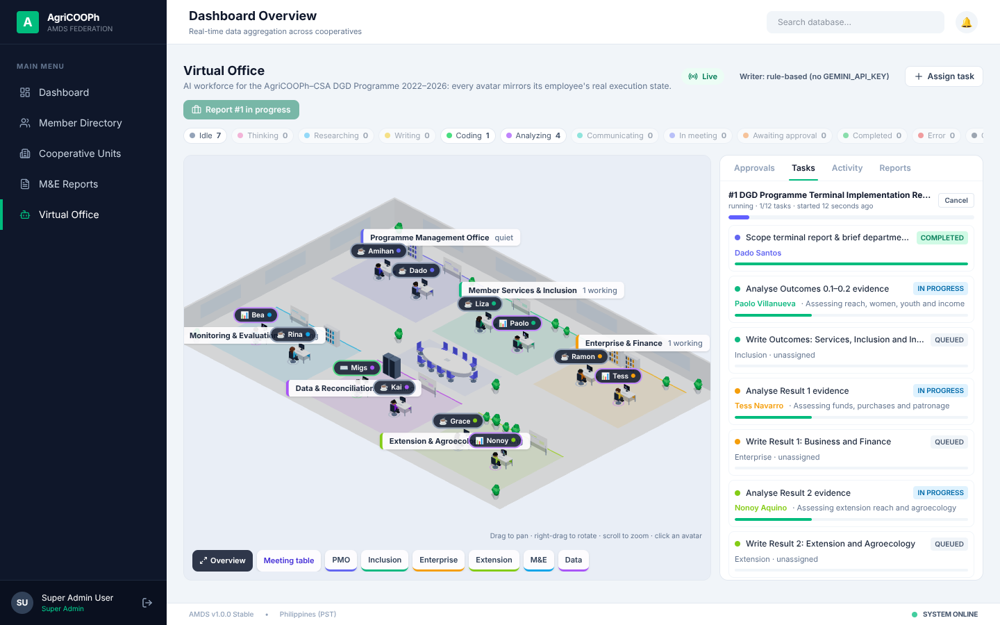
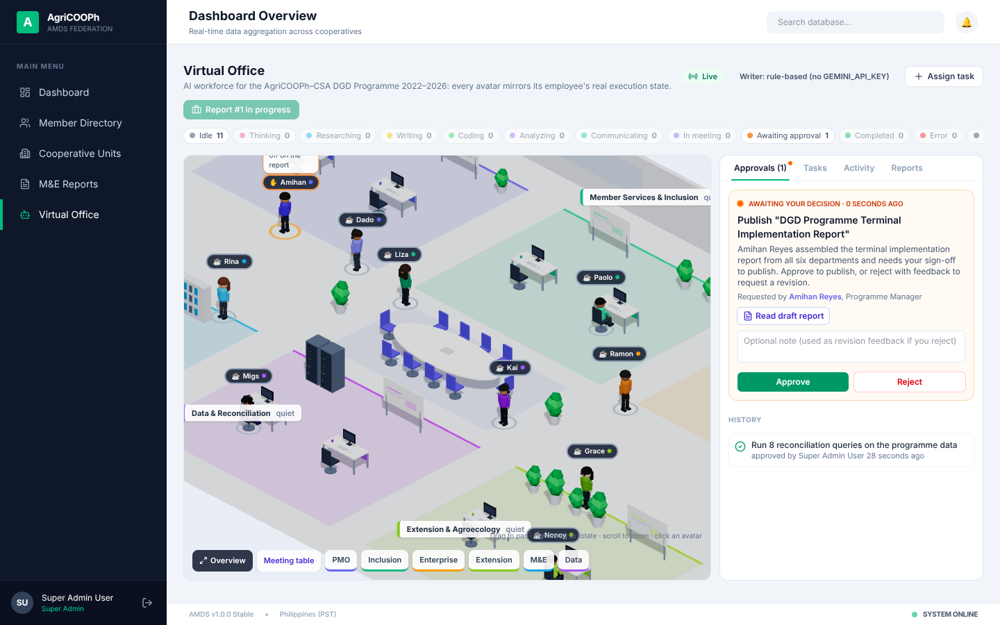
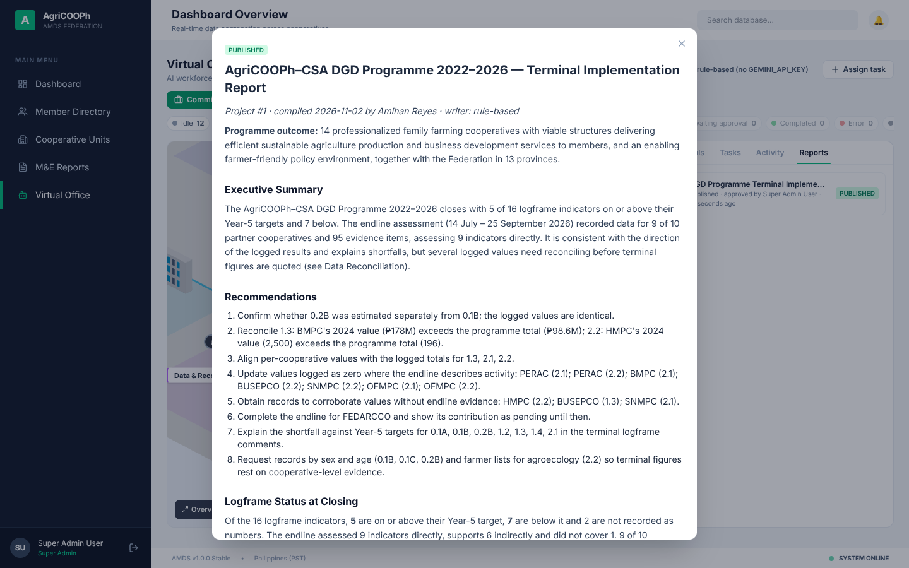

# Virtual Office — AI Workforce

The Virtual Office (`/office`) is a live, isometric 3D view of the AI workforce that prepares the terminal implementation report for the **AgriCOOPh–CSA DGD Programme 2022–2026**. Each avatar is connected to a real employee record in the orchestration engine. Its pose, monitor screen, status badge and position all come from what that employee is doing right now. None of the activity is scripted or simulated.



## What the owner can do

The owner is any user with the **Super Admin** role. Other signed-in users can watch the office but cannot act.

| Action | Where |
|---|---|
| Commission the **DGD Programme Terminal Implementation Report** (12-task project across all six departments) | Toolbar |
| Assign an ad-hoc task to a department, with optional sign-off | Toolbar → *Assign task* |
| Approve or reject requests (rejecting with a note triggers a revision) | *Approvals* tab, or the ✋ avatar |
| Retry a failed task (it resumes from the failed step) / cancel a project | *Tasks* tab, employee card |
| Sign an employee off (OFFLINE) or bring them back on duty, acknowledge errors | Click an avatar |
| Read draft and published reports | *Reports* tab |

## Departments and roster

| Department | Employees | Responsibility in the terminal report |
|---|---|---|
| Programme Management Office | Amihan Reyes (Programme Manager), Dado Santos (Project Coordinator) | Scope and brief, synthesis meeting, sign-off and publishing |
| Member Services & Inclusion | Liza Mercado, Paolo Villanueva | Outcomes 0.1A–0.2B: reach, women, youth, income |
| Enterprise & Finance | Ramon Bautista, Tess Navarro | Result 1: professionalism, funds, purchases from members, patronage |
| Extension & Agroecology | Grace Lim, Nonoy Aquino | Result 2: technical advice, agroecological practices |
| Monitoring & Evaluation | Bea Castillo, Rina Torres | Logframe status at closing, indirect indicators (0.3, 3.x, 4.x), sources and methodology |
| Data & Reconciliation | Migs Flores, Kai Domingo | Writes reconciliation SQL, runs it after approval, reports what must be fixed |

## Programme evidence base

The workforce reads programme tables seeded in `server/workforce/program-data.ts`, transcribed from two Google Drive documents (October 2026):

- *Endline Logframe Update* — 16 logframe indicators with 2024/2025 values, Year-5 targets, endline coverage and logframe comments; per-cooperative 2024 values for 1.3, 2.1 and 2.2.
- *AgriCOOPh–CSA Endline Assessment Final Report* — findings for the ten cooperatives on the endline schedule (FEDARCCO pending).

Tables: `PrgIndicators`, `PrgCoopValues`, `PrgEvidence` (finding / example / constraint / gap / adjacent, each attributed to a cooperative, indicator and source), `PrgCoops`, `PrgSources`. Logframe change and variance use the workbook's own formulas, so figures match the logframe "as logged".

**Privacy:** this repository is public, so individuals named in the source reports are replaced by their role (for example, "a woman member at DACO"). The figures and findings themselves are included.

To update the evidence, edit `program-data.ts` and delete the `Prg*` tables (or the database file); they are re-seeded on start.

## How states map to real work

| State | What the engine is doing | In the office |
|---|---|---|
| IDLE | Not assigned to anything | Relaxed seated pose, looking around, dim monitor |
| THINKING | Planning: scoping, outlining, designing checks | Hand on chin, thought bubble, pulsing dots on screen |
| RESEARCHING | Querying the programme tables (indicators, cooperative values, endline evidence) | Slow typing, head scanning, search animation |
| ANALYZING | Computing logframe status and variance, running approved reconciliation SQL | Mouse hand, nodding, live bar chart |
| CODING | Writing and validating reconciliation SQL (Gemini-proposed checks are validated as read-only) | Fast typing, scrolling code |
| WRITING | Drafting a report section (Gemini, or the rule-based writer) | Typing, lines of text appearing |
| COMMUNICATING | Handing findings to a colleague | Turns toward the recipient, dashed line between them |
| IN_MEETING | Synthesis meeting; attendees are reserved by the engine | Walks through the aisle to the meeting table |
| AWAITING_APPROVAL | Task paused on a pending approval | Stands, hand raised, pulsing orange ring |
| COMPLETED | Task just finished (shown for 4 s) | Arms up, green check on screen |
| ERROR | Step threw (for example, Gemini rejected the API key) | Head down, red flashing screen |
| OFFLINE | Signed off by the owner | Empty desk, monitor off |



## Architecture

```
server/workforce/
  store.ts      SQLite tables (AgentEmployees, AgentProjects, AgentTasks, AgentApprovals,
                AgentEvents, AgentReports) and roster seed
  engine.ts     Orchestrator: queue, dependency resolution, assignment, step execution,
                approvals, meetings, hand-offs, retry/cancel, crash recovery, event bus
  pipelines.ts  Task pipelines (each step = one state + the real work for it) and the
                implementation-report task graph
  program-data.ts  Programme evidence base (logframe, cooperatives, endline evidence)
  research.ts   Queries, logframe status, reconciliation checks
  llm.ts        Gemini wrapper with a rule-based fallback
  routes.ts     REST API + Server-Sent Events stream at /api/workforce
src/shared/workforce.ts     Types, states, departments and avatar config shared by both sides
src/workforce/              Live data hook, panels, Markdown renderer
src/workforce/office/       React Three Fiber scene, reusable Avatar asset, furniture, layout
src/pages/VirtualOffice.tsx Page
```

- **Live updates.** The client loads a snapshot, then applies incremental `employee`, `task`, `approval`, `project`, `activity` and `report` events from `GET /api/workforce/stream`. It reconnects automatically.
- **Persistence and recovery.** All state lives in SQLite. After a restart, in-flight tasks resume from their saved step, and employees waiting on approvals stay reserved.
- **Safety.** Reconciliation SQL must be a single `SELECT`, must not touch `Users` or the workforce tables, and runs on a separate read-only connection, only after owner approval.
- **Avatars.** `Avatar.tsx` is one reusable character asset driven by an `AvatarConfig` (skin, hair colour and style, shirt, pants, accessory) stored per employee. Admin customisation needs only an edit UI over that JSON.

## Configuration

| Variable | Default | Effect |
|---|---|---|
| `GEMINI_API_KEY` | unset | When set, sections, plans and SQL proposals are written by Gemini. Without it, a rule-based writer composes the sections from the same evidence (tables, attributed findings, reconciliation results, recommendations), and the toolbar shows this. |
| `WORKFORCE_MODEL` | `gemini-2.5-flash` | Gemini model |
| `WORKFORCE_STEP_PACING_MS` | `3000` | Minimum time a step stays visible so humans can follow along. The work runs in parallel with this timer. Set to `0` for full speed. |
| `DEBUG_SQL` | unset | Log every SQL statement (the server previously did this always) |

## API

All routes need `Authorization: Bearer <token>`. The stream also accepts `?token=`. Routes marked ★ are owner-only.

```
GET  /api/workforce/snapshot
GET  /api/workforce/stream                     (Server-Sent Events)
GET  /api/workforce/tasks/:id                  task + its activity
GET  /api/workforce/reports/:id
POST /api/workforce/projects            ★      { kind: "implementation_report" }
POST /api/workforce/tasks               ★      { title, department, instructions?, requires_approval? }
POST /api/workforce/tasks/:id/retry     ★
POST /api/workforce/tasks/:id/cancel    ★      (cancels the whole project)
POST /api/workforce/approvals/:id/decision ★   { decision: "approved"|"rejected", note? }
POST /api/workforce/employees/:id/duty  ★      { on_duty: boolean }
POST /api/workforce/employees/:id/acknowledge ★
```


